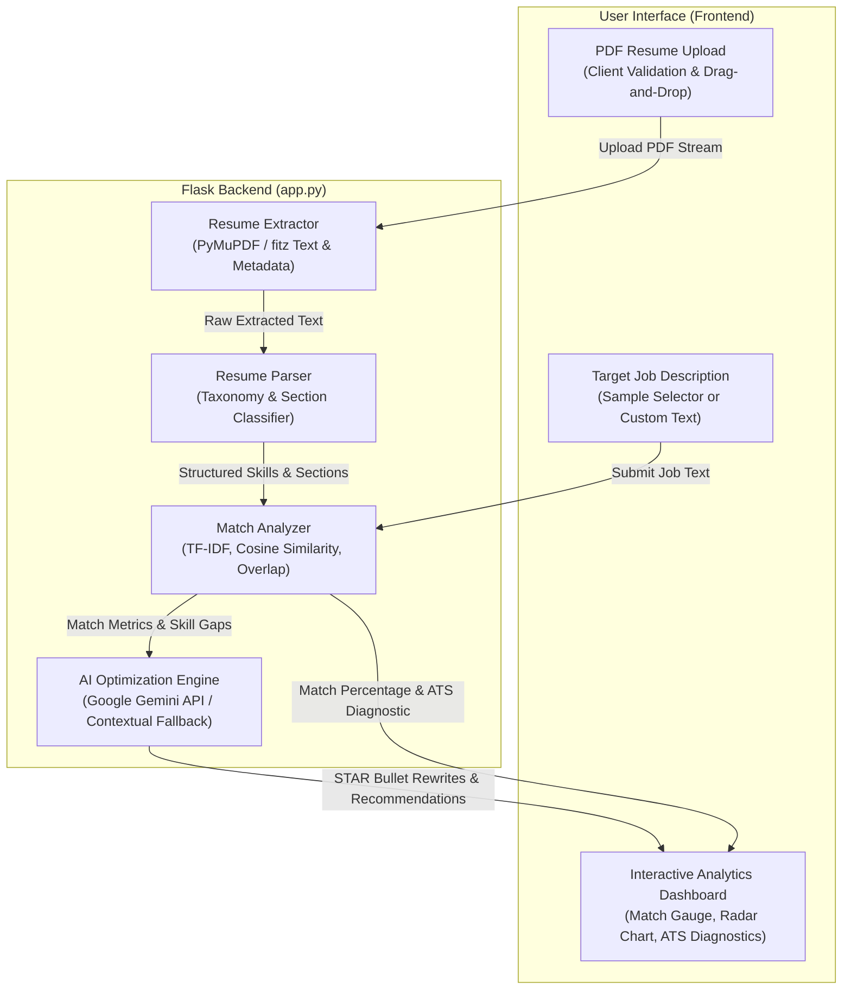

# Resume Analyzer

An intelligent, AI-powered web application that evaluates resume qualifications against target job descriptions. Resume Analyzer extracts readable text from PDF resumes using **PyMuPDF**, performs **TF-IDF cosine similarity** and keyword matching with **Scikit-learn**, audits **ATS compliance**, and delivers contextual, high-impact suggestions powered by **Google Gemini AI**.

---

## Table of Contents
1. [Objective & Overview](#objective--overview)
2. [Key Features](#key-features)
3. [Architecture & Analysis Methodology](#architecture--analysis-methodology)
4. [Technology Stack](#technology-stack)
5. [Project Structure](#project-structure)
6. [Local Installation & Setup](#local-installation--setup)
7. [Environment Configuration](#environment-configuration)
8. [Testing the Application](#testing-the-application)
9. [Evaluation Criteria Coverage](#evaluation-criteria-coverage)

---

## Objective & Overview
In modern recruitment workflows, Applicant Tracking Systems (ATS) and human recruiters screen hundreds of resumes within seconds. **Resume Analyzer** bridges the gap between candidates and job requirements by:
- Ingesting PDF resumes and extracting structured text and metadata.
- Extracting technical skills, soft skills, educational qualifications, work experience, projects, and contact info.
- Quantifying the resume-job alignment using a **hybrid scoring engine** combining TF-IDF vectorization and domain skill overlap.
- Auditing document formatting against ATS readability and structural standards.
- Delivering AI-generated actionable rewrites (STAR method), executive summary tailoring, and power action verbs.

> **Design Note:** In strict compliance with guidelines, this application does not use emoji icons anywhere in the user interface. All visual cues utilize sleek, minimalist SVG vector icons that adapt seamlessly to both Light and Dark themes.

---

## Key Features

### Core Requirements
- **PDF Resume Upload:** Drag-and-drop or file browser upload with server-side and client-side validation for file format (`.pdf`), size (`<= 10MB`), encryption, and non-empty text content.
- **Job Description Input:** Clean input area with real-time character and word count tracking, clear actions, and preloaded sample job descriptions.
- **PyMuPDF Text Extraction:** High-performance PDF text and layout extraction using `pymupdf`, handling multi-page documents and filtering out scanned/raster images.
- **Structured Information Extraction:**
  - Technical skills categorized by domain (Languages, Frameworks, Databases, Cloud/DevOps, AI/ML, Tools)
  - Soft skills and leadership competencies
  - Educational degrees, institutions, graduation dates, and GPAs
  - Work experience timelines, titles, companies, and accomplishment bullet points
  - Contact information (Email, Phone, LinkedIn, GitHub, Portfolios)
- **Hybrid Resume-Job Match Analysis:**
  - **TF-IDF Cosine Similarity** (35% weight) for semantic and vocabulary alignment
  - **Technical Skills Overlap** (40% weight) comparing required vs. present tools
  - **Soft Skills Overlap** (15% weight)
  - **ATS Completeness & Experience Depth** (10% weight)
- **Interactive Results Dashboard:**
  - Animated Donut Gauge for overall match percentage
  - Matched skills badges (present in resume)
  - Missing critical skills badges (required by JD)
  - Bonus candidate skills badges
  - Domain coverage radar chart and category progress bars
- **AI-Powered Suggestions:**
  - Direct integration with **Google Gemini API** (`gemini-2.5-flash`) via the official `google-genai` SDK.
  - Built-in contextual fallback engine ensuring 100% out-of-the-box functionality even without an API key.
  - Executive summary assessment and tailored rewrites.
  - Bullet point transformations using the STAR method (Situation, Task, Action, Result).
  - Power action verbs and keyword placement strategies.
- **Comprehensive Error Handling:** Informative feedback for invalid files, oversized documents, corrupt PDFs, empty job descriptions, and network interruptions.
- **Security & Secret Protection:** API keys and application secrets are managed strictly through environment variables (`.env`). No credentials are ever exposed in client-side code or Git history.

### Advanced Features
- **Dark & Light Mode:** Seamless theme toggle with CSS variables, smooth transitions, and persistent storage in `localStorage`.
- **Chart.js Visual Analytics:** Interactive Donut gauge and Domain Skill Coverage Radar chart.
- **Interactive Resume Improvement Assistant:** Standalone tool allowing candidates to paste individual weak bullet points and instantly receive 3 metric-driven, STAR-optimized revisions.
- **ATS-Friendly Diagnostic:** Automated checklist evaluating contact coordinates, standard section headers, document length (word count), and quantifiable metrics (%, $, numbers).
- **Downloadable & Printable Reports:** Export analyses as clean, printable PDF-ready reports or download raw analysis data as JSON.
- **Analysis History:** Local history drawer storing past evaluations with one-click reloading and score comparison.
- **Preloaded Sample Data:** Includes realistic sample job descriptions (Full Stack SWE, AI/ML Engineer, DevOps, Frontend) and preloaded sample resumes (Alex Turner, Priya Patel) with direct PDF preview links.

---

## Architecture & Analysis Methodology



### Match Scoring Formula

The overall match score is calculated using a weighted composite formula:

```math
Score_overall = (0.40 × S_tech) + (0.35 × S_tfidf) + (0.15 × S_soft) + (0.10 × S_ats)
```

#### Formula Breakdown & Weight Distribution

| Component | Weight | Metric Definition | Description |
| :--- | :---: | :--- | :--- |
| **Technical Skills ($S_{\text{tech}}$)** | **40%** | `(Matched Tech Skills / Required Tech Skills) × 100` | Measures coverage of essential programming languages, frameworks, databases, and cloud tools required by the job. |
| **TF-IDF Similarity ($S_{\text{tfidf}}$)** | **35%** | `CosineSimilarity(Resume_Vector, JD_Vector) × 140` | Computes semantic and vocabulary overlap between the resume content and the job description, scaled and bounded to $[0, 100]$. |
| **Soft Skills ($S_{\text{soft}}$)** | **15%** | `(Matched Soft Skills / Required Soft Skills) × 100` | Evaluates communication, leadership, problem-solving, and team collaboration keywords. |
| **ATS Compliance ($S_{\text{ats}}$)** | **10%** | `Checklist Score [0 - 100]` | Assesses contact information presence, standard section headers, optimal document word count, and measurable impact metrics. |

---

## Technology Stack

| Layer | Technologies |
| :--- | :--- |
| **Frontend** | HTML5, CSS3 (Custom Design System, Dark/Light Themes), Vanilla JavaScript (ES6+), Chart.js |
| **Backend** | Python 3.10+, Flask, Werkzeug, Gunicorn |
| **Document Processing** | PyMuPDF (`pymupdf`) |
| **Machine Learning & NLP**| Scikit-learn (`TfidfVectorizer`, `cosine_similarity`), NumPy, Regular Expressions |
| **AI Integration** | Google Gemini API (`google-genai` SDK) with local contextual AI fallback engine |
| **Icons & Visuals** | Minimalist vector SVG icons (Icons8 / Lucide style, zero emojis) |

---

## Project Structure

```
ResumeAnalyzer/
├── .env.example             # Template for local environment variables
├── .gitignore               # Ignores venv, .env, __pycache__, logs
├── Procfile                 # Production process definition for Render / Railway
├── runtime.txt              # Target Python runtime for deployment
├── requirements.txt         # Production dependencies
├── app.py                   # Main Flask application and API routes
├── modules/
│   ├── __init__.py
│   ├── extractor.py         # PyMuPDF text & metadata extraction with validation
│   ├── parser.py            # Information extraction (skills, education, experience, contact)
│   ├── analyzer.py          # TF-IDF, cosine similarity, ATS auditing, strengths & gaps
│   └── ai_suggester.py      # Google Gemini API integration and contextual fallback
├── static/
│   ├── css/
│   │   └── style.css        # Clean design system, Light & Dark themes, print styles
│   ├── js/
│   │   ├── app.js           # Main controller, file upload, API fetch, dashboard renderer
│   │   ├── charts.js        # Chart.js donut gauge and domain radar visualizations
│   │   ├── history.js       # Local history manager, PDF/report print, JSON exporter
│   │   └── assistant.js     # Interactive bullet point rephraser
│   └── icons/               # 28 SVG vector icons (no emojis)
├── templates/
│   └── index.html           # Accessible, semantic dashboard HTML template
└── sample_data/
    ├── sample_jobs.json     # Preloaded realistic job descriptions
    └── sample_resumes/      # Bundled sample resumes for instant testing
        ├── alex_turner_swe.pdf
        └── priya_patel_data_scientist.pdf
```

---

## Local Installation & Setup

### Prerequisites
- Python 3.10, 3.11, 3.12, 3.13, or 3.14 installed on your machine.
- Git installed.

### Step-by-Step Instructions

1. **Clone the repository:**
   ```bash
   git clone https://github.com/<your-username>/ResumeAnalyzer.git
   cd ResumeAnalyzer
   ```

2. **Create and activate a virtual environment:**
   - **On macOS / Linux:**
     ```bash
     python3 -m venv venv
     source venv/bin/activate
     ```
   - **On Windows (PowerShell):**
     ```powershell
     python -m venv venv
     .\venv\Scripts\Activate.ps1
     ```

3. **Install dependencies:**
   ```bash
   pip install -r requirements.txt
   ```

4. **Configure environment variables:**
   Copy `.env.example` to `.env`:
   ```bash
   cp .env.example .env
   ```
   Open `.env` in any text editor and optionally add your **Google Gemini API Key**:
   ```ini
   GEMINI_API_KEY=your_gemini_api_key_here
   GEMINI_MODEL=gemini-2.5-flash
   SECRET_KEY=a-secure-random-secret-key
   PORT=5000
   ```
   > **Note:** If you leave `GEMINI_API_KEY` blank, the application will automatically engage its **built-in contextual AI engine**, providing full functionality, personalized recommendations, and bullet improvements out of the box without requiring an API key.

5. **Run the Flask application:**
   ```bash
   python app.py
   ```

6. **Open in your browser:**
   Navigate to:
   ```
   http://localhost:5000
   ```

---

## Testing the Application

### 1-Click Fast Testing
1. On the homepage, under **Step 1: Upload Resume**, click on one of the preloaded sample resumes:
   - **Alex Turner (Full Stack Engineer)**
   - **Priya Patel (AI / Data Scientist)**
2. Under **Step 2: Job Description**, select a matching sample job from the **Load Sample Job Posting...** dropdown (e.g., *Full Stack Software Engineer* or *AI / Machine Learning Engineer*).
3. Click **Analyze Resume & Calculate Match**.
4. Explore the interactive results across all 4 dashboard tabs:
   - **Skills & Match Analysis**: Check matched vs. missing skills and the radar chart.
   - **AI Recommendations**: Review executive summary critique, tailored summary, and bullet upgrades.
   - **ATS Audit & Checklists**: Inspect ATS score and automated checklist.
   - **Parsed Qualifications**: Review candidate contact info, education, and career timeline.

### Testing Custom Resumes
- Drag and drop your own PDF resume into the upload zone (or click to browse).
- Paste any job posting from LinkedIn, Indeed, or company career pages.
- Click **Analyze Resume** to see your personalized results.

### Testing the Interactive Improvement Assistant
- Scroll down to the **Interactive Resume Improvement Assistant** section.
- Paste a bullet point (e.g., *"Helped the team make websites and fix bugs"*).
- Click **Rephrase with Metrics & Action Verbs** to generate 3 high-impact STAR revisions.

---

## Evaluation Criteria Coverage

| Criterion | Weight | Implementation Details |
| :--- | :---: | :--- |
| **Functionality** | **40%** | Robust PDF extraction with PyMuPDF; comprehensive information extraction (skills, education, experience, contact); hybrid scoring with Scikit-learn TF-IDF + cosine similarity + skill overlap; Gemini AI suggestions with fallback; thorough validation and error handling for corrupt/empty files. |
| **Code Quality** | **30%** | Clean, modular Python architecture (`extractor.py`, `parser.py`, `analyzer.py`, `ai_suggester.py`, `app.py`); clear separation of concerns; type hints and comprehensive docstrings; zero hardcoded credentials. |
| **UI / UX** | **20%** | Professional, modern responsive layout; custom Light and Dark theme backgrounds with persistent toggle; interactive Chart.js visualizations (gauge, radar, bars); clear skill tags; **zero emoji icons** (pure SVG vectors throughout); printable reports. |
| **Documentation & Git** | **10%** | Comprehensive README.md with architecture overview, mathematical formulations, local setup instructions, testing workflows, and clean Git commit history. |

---

## License
Developed as part of the **GDG AIML Selection Project**. Licensed under the [MIT License](LICENSE).

